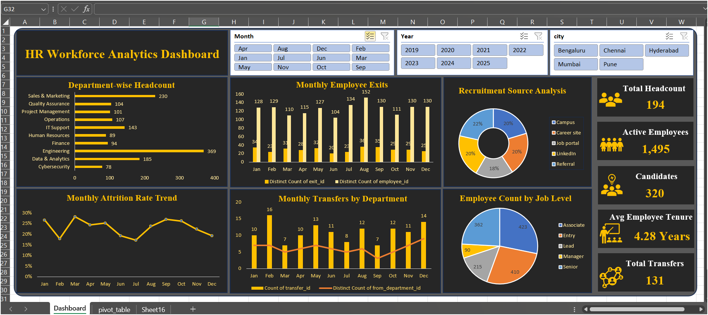
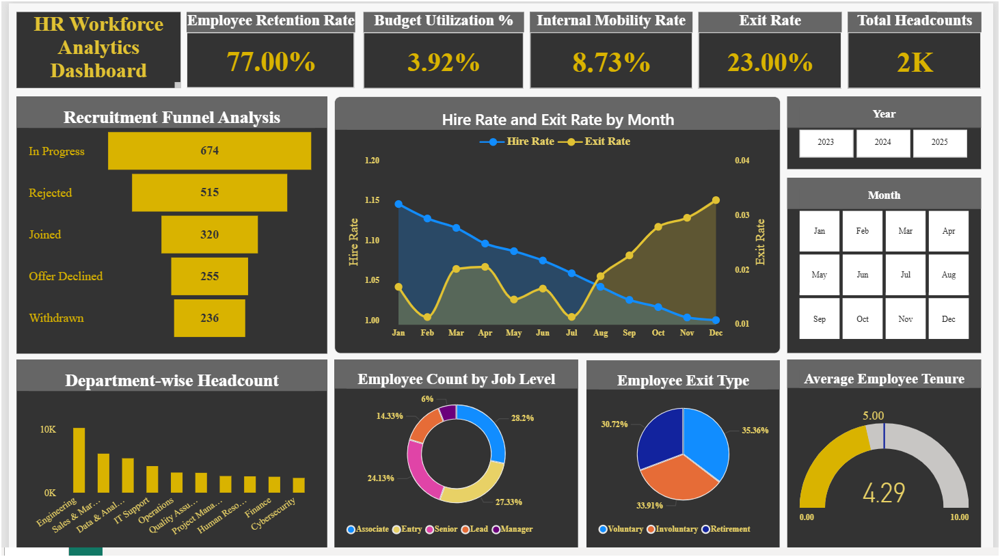

# HR Workforce Analytics Dashboard

An interactive HR analytics project developed using **Microsoft Excel and Power BI** to analyze workforce trends, recruitment, employee exits, attrition, and employee distribution.

## Project Overview

The project transforms HR data into meaningful business insights through interactive dashboards. It demonstrates how two different BI tools can be used to analyze the same business domain.

## Tools & Technologies

| Tool | Usage |
|---|---|
| Microsoft Excel | Data analysis and dashboard development |
| Power BI | Data modeling and interactive reporting |
| Power Query | Data transformation |
| DAX | Measures and KPI calculations |
| Pivot Tables & Charts | Data summarization and visualization |

## Dashboard Previews

### 1. Excel HR Analytics Dashboard



**Key Features:**
- Department-wise employee headcount
- Monthly employee exits
- Monthly attrition trends
- Recruitment source analysis
- Employee transfers by department
- Job-level distribution
- Interactive Year, Month, and City slicers

### 2. Power BI HR Analytics Dashboard



**Key Features:**
- Recruitment funnel analysis
- Hiring and exit rate analysis
- Department-wise workforce analysis
- Employee exit type analysis
- Job-level distribution
- Employee tenure analysis
- Interactive Year and Month filters

## Key Business Analysis

- Workforce distribution across departments
- Recruitment and hiring trends
- Employee attrition and retention
- Monthly employee exits
- Recruitment source effectiveness
- Employee transfers and job-level distribution

## Project Structure

```text
HR-Workforce-Analytics/
├── Raw_data/
├── excel/
│   ├── HR_Workforce_Analytics.xlsx
│   └── dashboard.png
├── powerbi/
│   ├── HR_Workforce_Analytics.pbix
│   └── dashboard.png
└── README.md
```

## Skills Demonstrated

- Data Cleaning and Transformation
- Data Analysis
- Data Modeling
- DAX
- Pivot Tables and Pivot Charts
- KPI Reporting
- Interactive Dashboard Development
- Business Intelligence

## Project Objective

To demonstrate practical data analytics skills by developing interactive HR dashboards in Excel and Power BI and translating workforce data into useful business insights.

---

**Tools:** Microsoft Excel | Power BI
